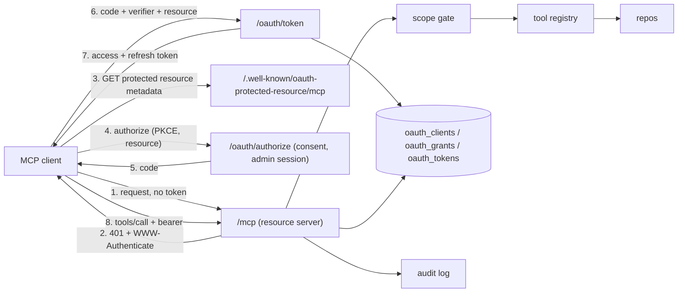

# MCP server

Transcode Forge exposes a [Model Context Protocol](https://modelcontextprotocol.io)
endpoint at `/mcp` so an AI client (Claude Code, Claude Desktop, claude.ai, or
any other MCP client) can read the catalog and the queue and, with the write
scope, queue or cancel work. The endpoint speaks the 2026-07-28 protocol revision
over Streamable HTTP and follows the
[MCP authorization specification](https://modelcontextprotocol.io/specification/2026-07-28/basic/authorization):
the server is an OAuth 2.1 resource server, every request carries a bearer
token, and a token minted for any other service is refused.

This document is the design record. The threat model, the controls and the
tests that prove them live in [MCP-THREAT-MODEL.md](MCP-THREAT-MODEL.md).

## Roles

OAuth has three parties.

| Role | Who | What it does |
|------|-----|--------------|
| Client | Claude Code, claude.ai, any MCP client | Asks for a token, then calls tools with it |
| Authorization server | Transcode Forge itself (default) or an external identity provider (Phase 3) | Signs the operator in, shows a consent page, issues and refreshes tokens |
| Resource server | The `/mcp` endpoint | Checks the token on every request, enforces scopes per tool, runs the tool |

Both server roles run in the Transcode Forge process by default, because a
self-hosted installation has no identity provider to point at. They are kept
separate in code: the resource server knows its authorization server only by
its issuer URL and by the token verifier it is given. Pointing the resource
server at an external issuer is configuration, not a rewrite.

## Architecture



Components:

- **Resource server.** The SDK's Streamable HTTP transport mounted at `/mcp`,
  wrapped in bearer authentication, protocol admission and the scope gate.
- **Protected resource metadata.** RFC 9728 document at
  `/.well-known/oauth-protected-resource/mcp` naming the canonical resource URL,
  the authorization server and the initial scope set.
- **Authorization server.** `/oauth/authorize`, `/oauth/consent`,
  `/oauth/token`, `/oauth/revoke` and the RFC 8414 metadata document, all in
  `mcp/authz.py`. Transcode Forge owns every check; the SDK supplies the
  request and metadata models and the redirect builder.
- **Grant store.** Four tables, described below.
- **Settings page.** A "Connected apps" section listing grants with a revoke
  action and the clients allowed to sign in. It also issues a manual grant
  for clients that configure a bearer header instead of running the browser
  flow.
- **Audit log.** One structured record per tool call.

## Authentication classes

Every route belongs to exactly one class. The classes never substitute for
each other: an admin session cookie never satisfies `/mcp`, and a bearer
token never satisfies an admin route.

| Routes | Authentication | CSRF check |
|--------|----------------|------------|
| `/mcp` | Bearer token resolving to a live grant | No (bearer, not cookie) |
| `/.well-known/oauth-protected-resource/*`, `/.well-known/oauth-authorization-server` | None (public metadata) | No |
| `/oauth/token`, `/oauth/revoke` | OAuth protocol rules (PKCE, registered client) | No |
| `/oauth/authorize` | None: it validates and parks the request, nothing is granted | No (GET) |
| `/oauth/consent`, page and decision | Admin session cookie | Yes, plus a consent nonce |
| `/api/mcp/*` (Settings) | Admin session cookie | Yes |

The auth middleware's public-prefix list is the single place this split is
declared.

## Canonical URL

The server has to know its own public URL for two reasons: it is the resource
identifier a token must be minted for, and it is the URL the metadata documents
advertise. `TF_PUBLIC_URL` holds the origin clients use (for example
`https://forge.example.com`). The canonical resource is `TF_PUBLIC_URL` plus
`/mcp`, with no trailing slash. It is never derived from the `Host` header or
any forwarded header, so a hostile header cannot move the audience.

## Grants and tokens

The unit of permission is the **grant**: one consent decision by one user for
one client, with a scope set, the resource it was minted for, a refresh
deadline and a revocation timestamp. Every access token, refresh token and
authorization code belongs to a grant. Revoking the grant ends all of them at
their next check. Widening a grant's scopes takes a new consent; existing
tokens never gain permissions.

Tokens are 32 random bytes, URL-safe encoded, and are stored only as
HMAC-SHA256 digests under the token pepper that already protects worker
tokens. The digest input is prefixed with the token kind (`mcp-access`,
`mcp-refresh`, `mcp-code`), so a worker token, or a refresh token, can never
verify as an access token even though they share a key. The raw value is shown
once at issue time and is never written to the database or a log.

| Kind | Lifetime | Notes |
|------|----------|-------|
| Access | 1 hour | Verified on every request by one lookup |
| Refresh | 30 days from authorization | Rotated on use; a replayed refresh token revokes the whole grant |
| Code | 10 minutes | Single use; lives on its authorization transaction; consumed by one conditional update, and a reuse revokes the grant |

Verification is one query: token digest, then the grant, then the client. The
token must be the expected kind and unexpired, the grant unrevoked and inside
its refresh deadline, the client enabled, the grant's resource equal to the
canonical resource, and the grant's scopes a superset of what the tool needs.

### Schema

| Table | Purpose | Key columns |
|-------|---------|-------------|
| `oauth_clients` | Known clients | `id` (the client id), `kind` (`cimd` or `admin`), `name`, `redirect_uris` (JSON list), `metadata_url`, `metadata_fetched_at`, `disabled_at` |
| `oauth_grants` | Consent decisions | `id`, `client_id`, `user_id`, `scopes` (space separated), `resource`, `label`, `created_at`, `expires_at`, `revoked_at` |
| `oauth_tokens` | Access and refresh tokens under a grant | `token_hash` (primary key), `grant_id`, `kind`, `created_at`, `expires_at`, `consumed_at` |
| `oauth_transactions` | One authorization request from start to finish | `id`, `client_id`, `redirect_uri`, `code_challenge`, `scopes`, `resource`, `state`, `nonce_hash`, `expires_at`, `approved_at`, `grant_id`, `code_hash`, `consumed_at` |

## Scopes

| Scope | Covers | Tools |
|-------|--------|-------|
| `catalog:read` | Libraries and the media catalog | `list_libraries`, `list_media` |
| `jobs:read` | Jobs, queue state, statistics | `list_jobs`, `get_job`, `queue_summary`, `stats` |
| `jobs:write` | Queueing and cancelling work | `queue_file`, `cancel_job` |

The metadata document advertises `catalog:read jobs:read` as the initial set.
A write scope is only ever obtained through a step-up consent triggered by a
403 challenge, never granted up front.

## Per-tool authorization

One registry maps each tool name to the scopes it needs and the function that
implements it. Tool registration and the scope gate both read that table, so
a tool cannot exist without a policy and the policy cannot drift from the
code.

The 2026-07-28 transport requires every POST to carry `MCP-Protocol-Version`,
`Mcp-Method` and, for named operations such as `tools/call`, `Mcp-Name`. The
SDK rejects any request whose headers disagree with its body before the
operation runs. That makes an HTTP-level gate safe: the gate authorizes the
operation the headers name, and the transport then proves the body names the
same operation.

Order of checks on `/mcp`:

1. **Bearer authentication.** Missing or invalid token: `401` with
   `WWW-Authenticate: Bearer resource_metadata="..."`.
2. **Protocol admission.** `MCP-Protocol-Version` must name a supported modern
   revision (`2026-07-28`). The legacy session-based transport is not served,
   so a request without the header, or carrying a 2025 revision, is refused
   with `400`.
3. **Scope gate.** `tools/call` must carry `Mcp-Name`; the name must be in the
   registry; the grant's scopes must cover the tool's scopes. Otherwise `403`
   with `WWW-Authenticate: Bearer error="insufficient_scope", scope="...",
   resource_metadata="..."`. An unknown name is refused, never treated as
   "no scope required". Discovery methods (`server/discover`, `tools/list`,
   `resources/list`, `prompts/list`) need only authentication.
4. **Transport.** Header and body consistency, then dispatch.

No repository call happens before step 4 succeeds.

## Limits and audit

- Request bodies are capped at 1 MiB.
- Each grant has a request budget per minute; the surplus is answered `429`.
- Every `tools/call` writes one audit record: grant id, client id, tool,
  decision and reason, outcome, duration and a correlation id. Tokens and
  tool arguments are never logged.

## Authorization server

Every endpoint of the authorization server is Transcode Forge code in one
module, `mcp/authz.py`, mounted by the same `TF_PUBLIC_URL` switch as
`/mcp`. The SDK's own authorization handlers are not used. In the pinned
SDK they drop the token request's `resource`, load a code in one call and
redeem it in another, match redirect URIs exactly, build metadata without
the two flags the Claude clients check, and send error redirects without
`iss`. Owning the four endpoints means a reviewer finds PKCE, the resource
check and the replay rule in this repository, and an SDK upgrade cannot move
them. The SDK still supplies the request and metadata models, the redirect
builder and the CORS wrapper.

- **One transaction row per request.** `/oauth/authorize` validates the
  request (a registered client, a registered redirect URI, S256 PKCE, known
  scopes, the canonical `resource`) and stores it in `oauth_transactions`,
  then sends the browser to `/oauth/consent`. Rendering the consent page
  arms the row with a nonce; approving it records `approved_at`, creates the
  grant and stores the code's digest on the same row; redeeming the code
  sets `consumed_at`. That one column is the single conditional update that
  makes a code single use. An unauthenticated administrator is sent to
  `/login` and returned to the consent page afterwards.
- **Client registration.** Two kinds, both rows of `oauth_clients`, both
  public clients (PKCE always, no secret). A `cimd` client is identified by
  the HTTPS URL of its metadata document; allowing the URL in Settings is
  the whole registration, and the Claude Code document is allowed on every
  installation that turns the endpoint on. The document is fetched at
  authorization time by `mcp/cimd.py` with the guard the threat model
  describes (HTTPS only, public addresses only, the connection pinned to the
  vetted address, no redirects, size and time bounds, the document's own
  `client_id` equal to its URL), then cached on the row for an hour. An
  `admin` client is created in Settings with a name and exact redirect URIs,
  for clients that publish no document. Dynamic client registration is not
  offered; the metadata advertises `client_id_metadata_document_supported`
  and `none` as the token endpoint authentication method, which is what the
  Claude clients require before they use their document.
- **Redirect URIs.** Exact string match of scheme, host, path and query,
  with one exception from RFC 8252 section 7.3: a registered loopback URI
  (`localhost`, `127.0.0.1`, `[::1]`) matches any port, because native
  clients bind an ephemeral port and Claude Code declares both loopback
  names. An unregistered redirect URI gets a direct `400`, never a redirect.
- **Consent.** The page names the client by the host of its document URL
  first (a document is self-asserted), the scopes in words, and the host the
  browser returns to, with a warning when that host is a loopback address.
  Approval needs the admin session, the nonce the page carried, and a
  same-origin POST; the page is served with `frame-ancestors 'none'`. Being
  logged in is not consent: a crafted authorize link grants nothing until
  the form is posted. Denying sends `access_denied`.
- **Token endpoint.** `resource` is required at the code exchange and must
  equal the canonical resource; on a refresh it is checked when present.
  The code is consumed before anything else is checked, by one conditional
  update whose marker is read back after the commit (on SQLite every
  request shares one connection, and another request's rollback between
  the update and the commit would otherwise erase a consumption the cursor
  had already reported), so a wrong verifier or a wrong client burns it,
  and a second redemption revokes the grant the code created. Consumption
  and issuance are two commits: a crash between them fails closed, the code
  is spent and the client authorizes again. Refresh tokens rotate on use,
  inherit the grant's deadline, and a consumed one presented again revokes
  the grant. A refresh asking for more than its grant holds is refused; the
  grant's full scope is what is issued and reported either way. Expired
  transactions are purged, so a code older than its ten minutes is refused
  without naming a grant to revoke. The public endpoints share the
  per-minute budget `/mcp` applies, keyed by the caller's address. The
  response is never cacheable.
- **Revocation endpoint.** RFC 7009: a client revokes a grant by either of
  its tokens; a token that belongs to another client, or to nobody, is
  answered `200` without effect.
- **Responses.** The `iss` parameter is on every authorization response,
  success and error, and the metadata advertises it.
- **Audit.** Consent decisions, token issuance, replays and revocations are
  JSON records on the `transcode_forge.mcp.audit` logger, never carrying a
  code, a verifier or a token.

## External issuer mode (Phase 3)

`TF_MCP_ISSUER` selects the mode. `local` (default) runs the embedded
authorization server. `external` takes an issuer URL, fetches its signing keys,
verifies JWT access tokens (algorithm allowlist, issuer, audience equal to the
canonical resource, expiry and not-before with bounded leeway, scope claim),
points the protected resource metadata at that issuer and does not mount the
local OAuth routes. The modes never fall back to each other, and an external
identity is mapped to the administrator only through an explicit subject
allowlist. This is the mode an enterprise identity provider uses; the resource
server, the scope gate, the registry and the audit log are identical in both.

## Deployment contract

- TLS terminates at a reverse proxy; the MCP authorization specification and
  the MCP clients require HTTPS everywhere except loopback.
- `TF_PUBLIC_URL` equals the URL clients use, character for character.
- Forwarded headers are trusted only from the proxy.
- Hosted clients such as claude.ai need network reachability to the
  installation; OAuth does not make a private address reachable.
- Clients have to speak the 2026-07-28 revision. Claude Code's current runtime
  does; a session pinned to the older runtime cannot connect.

## Connecting a client

1. Set `TF_PUBLIC_URL` to the HTTPS origin the client will use and restart.
   The Claude Code client document is allowed at that moment; disable it
   under Settings, Connected apps, if you do not want it.
2. Give the client the URL. For Claude Code:

   ```bash
   claude mcp add --transport http forge https://forge.example.com/mcp
   ```

   then run `/mcp` inside Claude Code to sign in. The browser opens on the
   consent page (after the login page, if needed), you allow the scopes, and
   the client holds its own token from then on. For claude.ai, add the URL
   under Customize, Connectors, Add custom connector, with "Use Claude's
   published identity". If the authorize step refuses a client that is not
   allowed yet, the error names the document URL; allow it under Settings.
3. A tool that needs a scope the grant does not hold answers `403` with the
   scope; the client asks you to re-authorize and retries. A write grant
   is only ever obtained this way.
4. Revoke the grant under Settings, Connected apps, when the client is
   retired; the token stops working at its next request. Disabling a
   client cuts off every grant it holds.

A client that cannot run the browser flow still gets a manual grant from
the same page and sends it as a bearer header:

```bash
claude mcp add --transport http forge https://forge.example.com/mcp --header "Authorization: Bearer <token>"
```

The client has to speak the 2026-07-28 revision; Claude Code's current
runtime does (`MCP_SDK_GENERATION=v2` forces it).

## Phases

| Phase | Delivers | Done when |
|-------|----------|-----------|
| 1 | Resource server, grant store, read-only tools, manual grants from Settings | The wire tests in the threat model pass on SQLite and Postgres; a manual grant works from Claude Code with a bearer header |
| 2 | Embedded authorization server, metadata-document and admin clients, consent, refresh, revocation, `jobs:write` with `queue_file` and `cancel_job` | Claude Code and claude.ai connect with no configuration beyond the URL; the step-up challenge round trip passes |
| 3 | External issuer mode | The same authorization tests pass against an external identity provider; disabled-mode routes cannot mint or accept credentials |
| 4 | Adversarial review, deployment runbook, release | Every threat-model row is `tested` |

## Out of scope for v1

Multi-user data isolation (the installation has one administrator), the
enterprise identity-assertion grant, dynamic client registration, tools that
run commands or fetch arbitrary URLs, and worker-side use of MCP.

## Dependencies

The official `mcp` package, pinned in `uv.lock`. Its transport, bearer
authentication middleware and header validation are used as published; its
authorization handlers are not (see "Authorization server"). The version is
bumped deliberately and the tests in the threat model are the regression
gate.
