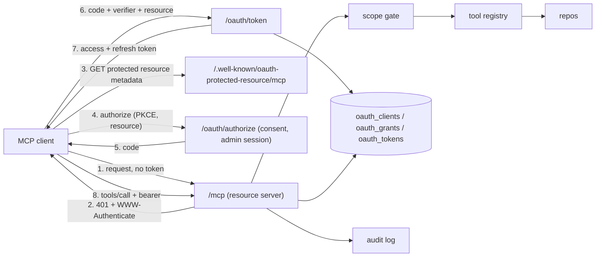

# MCP server

Transcode Forge exposes a [Model Context Protocol](https://modelcontextprotocol.io)
endpoint at `/mcp` so an AI client (Claude Code, Claude Desktop, claude.ai, or
any other MCP client) can read the catalog and the queue and, from Phase 2,
queue or cancel work. The endpoint speaks the 2026-07-28 protocol revision
over Streamable HTTP and follows the
[MCP authorization specification](https://modelcontextprotocol.io/specification/2026-07-28/basic/authorization):
the server is an OAuth 2.1 resource server, every request carries a bearer
token, and a token minted for any other service is refused.

This document is the design record. The threat model, the controls and the
tests that prove them live in [MCP-THREAT-MODEL.md](MCP-THREAT-MODEL.md).

## Roles

OAuth has three parties.

| Role | Who | What it does |
|------|-----|--------------|
| Client | Claude Code, claude.ai, any MCP client | Asks for a token, then calls tools with it |
| Authorization server | Transcode Forge itself (default) or an external identity provider (Phase 3) | Signs the operator in, shows a consent page, issues and refreshes tokens |
| Resource server | The `/mcp` endpoint | Checks the token on every request, enforces scopes per tool, runs the tool |

Both server roles run in the Transcode Forge process by default, because a
self-hosted installation has no identity provider to point at. They are kept
separate in code: the resource server knows its authorization server only by
its issuer URL and by the token verifier it is given. Pointing the resource
server at an external issuer is configuration, not a rewrite.

## Architecture

Components:

- **Resource server.** The SDK's Streamable HTTP transport mounted at `/mcp`,
  wrapped in bearer authentication, protocol admission and the scope gate.
- **Protected resource metadata.** RFC 9728 document at
  `/.well-known/oauth-protected-resource/mcp` naming the canonical resource URL,
  the authorization server and the initial scope set.
- **Authorization server (Phase 2).** `/oauth/authorize`, `/oauth/token`,
  `/oauth/revoke` and the RFC 8414 metadata document. The SDK supplies the
  protocol handlers; Transcode Forge supplies client lookup, the consent page,
  grant storage and token minting.
- **Grant store.** Three tables, described below.
- **Settings page.** A "Connected apps" section listing grants with a revoke
  action. In Phase 1 it also issues a manual grant for clients that configure
  a bearer header instead of running the browser flow.
- **Audit log.** One structured record per tool call.

## Authentication classes

Every route belongs to exactly one class. The classes never substitute for
each other: an admin session cookie never satisfies `/mcp`, and a bearer
token never satisfies an admin route.

| Routes | Authentication | CSRF check |
|--------|----------------|------------|
| `/mcp` | Bearer token resolving to a live grant | No (bearer, not cookie) |
| `/.well-known/oauth-protected-resource/*`, `/.well-known/oauth-authorization-server` | None (public metadata) | No |
| `/oauth/token`, `/oauth/revoke` | OAuth protocol rules (PKCE, registered client) | No |
| `/oauth/authorize`, the consent form | Admin session cookie | Yes, plus a consent nonce |
| `/api/mcp/*` (Settings) | Admin session cookie | Yes |

The auth middleware's public-prefix list is the single place this split is
declared.

## Canonical URL

The server has to know its own public URL for two reasons: it is the resource
identifier a token must be minted for, and it is the URL the metadata documents
advertise. `TF_PUBLIC_URL` holds the origin clients use (for example
`https://forge.example.com`). The canonical resource is `TF_PUBLIC_URL` plus
`/mcp`, with no trailing slash. It is never derived from the `Host` header or
any forwarded header, so a hostile header cannot move the audience.

## Grants and tokens

The unit of permission is the **grant**: one consent decision by one user for
one client, with a scope set, the resource it was minted for, a refresh
deadline and a revocation timestamp. Every access token, refresh token and
authorization code belongs to a grant. Revoking the grant ends all of them at
their next check. Widening a grant's scopes takes a new consent; existing
tokens never gain permissions.

Tokens are 32 random bytes, URL-safe encoded, and are stored only as
HMAC-SHA256 digests under the token pepper that already protects worker
tokens. The digest input is prefixed with the token kind (`mcp-access`,
`mcp-refresh`, `mcp-code`), so a worker token, or a refresh token, can never
verify as an access token even though they share a key. The raw value is shown
once at issue time and is never written to the database or a log.

| Kind | Lifetime | Notes |
|------|----------|-------|
| Access | 1 hour | Verified on every request by one lookup |
| Refresh | 30 days from authorization | Rotated on use; a replayed refresh token revokes the whole grant |
| Code | 10 minutes | Single use; consumed atomically with issuance |

Verification is one query: token digest, then the grant, then the client. The
token must be the expected kind and unexpired, the grant unrevoked and inside
its refresh deadline, the client enabled, the grant's resource equal to the
canonical resource, and the grant's scopes a superset of what the tool needs.

### Schema

| Table | Purpose | Key columns |
|-------|---------|-------------|
| `oauth_clients` | Known clients | `id` (the client id), `kind` (`cimd` or `admin`), `name`, `redirect_uris` (JSON list), `metadata_url`, `disabled_at` |
| `oauth_grants` | Consent decisions | `id`, `client_id`, `user_id`, `scopes` (space separated), `resource`, `label`, `created_at`, `expires_at`, `revoked_at` |
| `oauth_tokens` | Credentials under a grant | `token_hash` (primary key), `grant_id`, `kind`, `created_at`, `expires_at`, `consumed_at` |

## Scopes

| Scope | Covers | Tools |
|-------|--------|-------|
| `catalog:read` | Libraries and the media catalog | `list_libraries`, `list_media` |
| `jobs:read` | Jobs, queue state, statistics | `list_jobs`, `get_job`, `queue_summary`, `stats` |
| `jobs:write` | Queueing and cancelling work (Phase 2) | `queue_file`, `cancel_job` |

The metadata document advertises `catalog:read jobs:read` as the initial set.
A write scope is only ever obtained through a step-up consent triggered by a
403 challenge, never granted up front.

## Per-tool authorization

One registry maps each tool name to the scopes it needs and the function that
implements it. Tool registration and the scope gate both read that table, so
a tool cannot exist without a policy and the policy cannot drift from the
code.

The 2026-07-28 transport requires every POST to carry `MCP-Protocol-Version`,
`Mcp-Method` and, for named operations such as `tools/call`, `Mcp-Name`. The
SDK rejects any request whose headers disagree with its body before the
operation runs. That makes an HTTP-level gate safe: the gate authorizes the
operation the headers name, and the transport then proves the body names the
same operation.

Order of checks on `/mcp`:

1. **Bearer authentication.** Missing or invalid token: `401` with
   `WWW-Authenticate: Bearer resource_metadata="..."`.
2. **Protocol admission.** `MCP-Protocol-Version` must name a supported modern
   revision (`2026-07-28`). The legacy session-based transport is not served,
   so a request without the header, or carrying a 2025 revision, is refused
   with `400`.
3. **Scope gate.** `tools/call` must carry `Mcp-Name`; the name must be in the
   registry; the grant's scopes must cover the tool's scopes. Otherwise `403`
   with `WWW-Authenticate: Bearer error="insufficient_scope", scope="...",
   resource_metadata="..."`. An unknown name is refused, never treated as
   "no scope required". Discovery methods (`server/discover`, `tools/list`,
   `resources/list`, `prompts/list`) need only authentication.
4. **Transport.** Header and body consistency, then dispatch.

No repository call happens before step 4 succeeds.

## Limits and audit

- Request bodies are capped at 1 MiB.
- Each grant has a request budget per minute; the surplus is answered `429`.
- Every `tools/call` writes one audit record: grant id, client id, tool,
  decision and reason, outcome, duration and a correlation id. Tokens and
  tool arguments are never logged.

## Authorization server (Phase 2)

The SDK's handlers provide the `/authorize`, `/token` and `/revoke` endpoints
and the metadata document, and already enforce PKCE with `S256`, exact
`redirect_uri` matching, authorization code expiry and the `resource`
parameter's plumbing. Transcode Forge owns the rest:

- **Client registration.** Two kinds. A `cimd` client identifies itself with
  an HTTPS URL that serves its metadata document; the document is fetched with
  an SSRF guard (HTTPS only, public addresses only, redirects not followed,
  size and time bounds) and accepted only when the URL is on an allowlist the
  operator edits in Settings, seeded with the Claude clients. An `admin`
  client is created by the operator in Settings with a name and exact redirect
  URIs. Both are public clients: PKCE is mandatory and no client secret exists.
  Dynamic client registration is not offered; the metadata advertises
  `client_id_metadata_document_supported` and `none` as the token endpoint
  authentication method so clients that support metadata documents choose
  them.
- **Redirect URIs.** Exact string match, with one exception from RFC 8252
  section 7.3: a registered loopback URI matches any port, because native
  clients bind an ephemeral port. Scheme, host and path still have to match.
- **Consent.** The authorize endpoint validates the request, stores a
  short-lived transaction (client, redirect URI, PKCE challenge, scopes,
  resource) and renders the consent page to the logged-in administrator.
  Approval requires the admin session and a nonce bound to that transaction.
  Being logged in is not consent. Approval creates the grant and the code in
  one transaction.
- **Token endpoint.** The `resource` parameter is required at both
  authorization and token time and must equal the canonical resource; the SDK
  parses it but does not validate it, so that check is Transcode Forge's.
  Codes are consumed atomically with issuance. Refresh tokens rotate on use;
  a consumed refresh token presented again revokes the grant.
- **Responses.** The `iss` parameter is included on authorization responses,
  including error redirects, and the metadata advertises it.

## External issuer mode (Phase 3)

`TF_MCP_ISSUER` selects the mode. `local` (default) runs the embedded
authorization server. `external` takes an issuer URL, fetches its signing keys,
verifies JWT access tokens (algorithm allowlist, issuer, audience equal to the
canonical resource, expiry and not-before with bounded leeway, scope claim),
points the protected resource metadata at that issuer and does not mount the
local OAuth routes. The modes never fall back to each other, and an external
identity is mapped to the administrator only through an explicit subject
allowlist. This is the mode an enterprise identity provider uses; the resource
server, the scope gate, the registry and the audit log are identical in both.

## Deployment contract

- TLS terminates at a reverse proxy; the MCP authorization specification and
  the MCP clients require HTTPS everywhere except loopback.
- `TF_PUBLIC_URL` equals the URL clients use, character for character.
- Forwarded headers are trusted only from the proxy.
- Hosted clients such as claude.ai need network reachability to the
  installation; OAuth does not make a private address reachable.
- Clients have to speak the 2026-07-28 revision. Claude Code's current runtime
  does; a session pinned to the older runtime cannot connect.

## Phases

| Phase | Delivers | Done when |
|-------|----------|-----------|
| 1 | Resource server, grant store, read-only tools, manual grants from Settings | The wire tests in the threat model pass on SQLite and Postgres; a manual grant works from Claude Code with a bearer header |
| 2 | Embedded authorization server, metadata-document and admin clients, consent, refresh, revocation, `jobs:write` with `queue_file` and `cancel_job` | Claude Code and claude.ai connect with no configuration beyond the URL; the step-up challenge round trip passes |
| 3 | External issuer mode | The same authorization tests pass against an external identity provider; disabled-mode routes cannot mint or accept credentials |
| 4 | Adversarial review, deployment runbook, release | Every threat-model row is `tested` |

## Out of scope for v1

Multi-user data isolation (the installation has one administrator), the
enterprise identity-assertion grant, dynamic client registration, tools that
run commands or fetch arbitrary URLs, and worker-side use of MCP.

## Dependencies

The official `mcp` package, pinned in `uv.lock`. Its transport, bearer
authentication middleware, authorization handlers and header validation are
used as published; the version is bumped deliberately and the tests in the
threat model are the regression gate.
